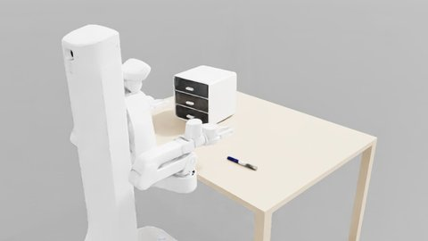

# 000003：沿桌边移动，收笔入抽屉



机器人从桌子 −Y 边中央出发，用共享技能开下层抽屉、拿起桌上的笔、放进抽屉、关抽屉。拿笔与放置分别记录子任务，共用一个步骤，保持步骤检查点之间手里不拿物体；抓取检查实际抬升，另检查开度、笔在抽屉内和最终关好后仍在抽屉内。

笔的位置覆盖桌边的全部可用宽度，朝向为整圈均匀随机。整支笔位于距工作侧桌边 4–26 cm 的带内，最深处距起始底盘约 55 cm；按每个朝向的资产碰撞外形留出桌边余量。柜子也覆盖其完整抽屉行程仍能留在桌上的全部可用宽度，纵向原点在 0–6 cm，朝向为 ±30°。柜体约 28.6×29.5 cm、抽屉行程约 17.3 cm，30°时完整扫掠区仍能在 1.36 m 宽桌面内沿横向移动。实际尺寸和行程始终从资产读取。

场景不要求导航：柜子朝工作侧，抽屉向工作侧拉出；笔完全位于前沿可接近带。生成时按资产几何排除柜体及全行程抽屉扫掠越出桌面、笔与其保守水平扫掠包围盒重叠、物体穿透的布局。地面没有额外障碍，目标都能从同一侧面对，技能仍须自行验证局部底盘路线及手臂路径；起始转向扫到桌沿时，可先沿当前朝向退开，再转向目标。没有预先按专家、IK或规划成功与否筛初态，也没有要求绕到桌子另一侧。

开发初态写入新的运行目录，避免覆盖已有资产；例如：

```bash
python scripts/scenes/build_scene.py 000003 --seeds 0:20 --output runs/expert/000003/initials-screen --jobs 5 --launcher 'gq submit --mem 6 --util 60 --wait --'
python scripts/scenes/run_expert.py 000003 --dev --seeds 0:20 --input runs/expert/000003/initials-screen --problems all --jobs 5 --launcher 'gq submit --mem 6 --util 60 --wait --'
```
