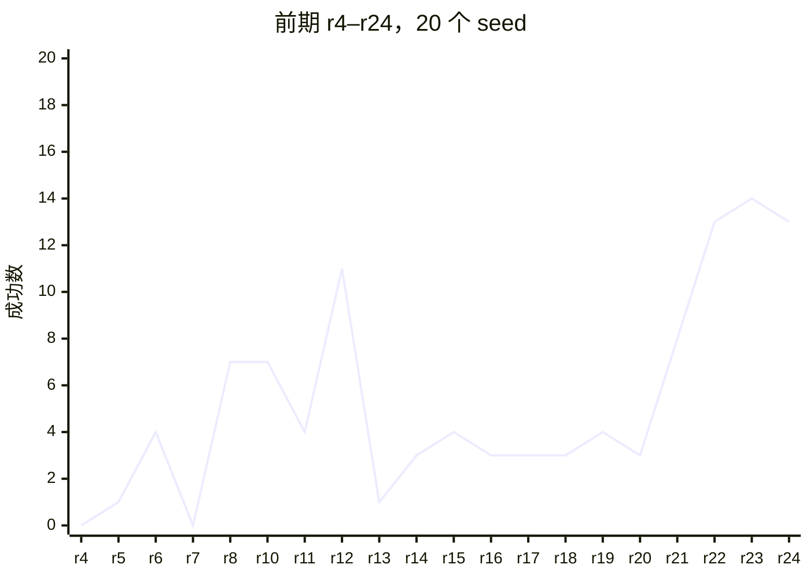

# 场景 000002 专家迭代

关联：#34–#39、#45、#49、#51、#52；PR #26、#39、#52、#60。研究方案见[专家迭代](../../research/expert-iteration.md)。

全部轮次见 [rounds.csv](rounds.csv)：每轮的 commit 及其依据、初态、`--skill-attempts`、成功数、成功轨迹的平均 sim time、全部尝试的平均 wall time 和改动。

`commit_basis` 为 `reported`、`frozen-copy-matches` 或 `frozen-copy-docstring-differs` 的行可以复现：代码就是那个 commit，commit 属于某个 PR。其余的行是历史观察，代码与 commit 的对应没有逐文件核实，只用来看迭代的走向，不作为复现依据。

## 20261025 从 0 到 98% 的迭代历史

### 问题

场景 000002（上层抽屉取笔、放桌面、关上层、开下层、笔放进下层、关下层）从第一版专家到 98% 的过程中，每轮改动对完整任务成功率有什么影响；有了失败复现工具前后，迭代有什么不同。

### 结论

- 前期（10-23 凌晨，r4–r24，每轮 20 个 seed）：约 5 小时内从 0/20 提高到 14/20。r12 达到 11/20 后，r13 降到 1/20，r13–r20 共 8 轮停在 1–4/20。这一阶段每轮改多处，没有回退到更好的版本，也没有在原失败案例上确认改动是否起作用。
- 只加记录与复现工具（#49、#51、#52）时，原 0:300 为 264–268/300，工具本身不改变成功率。
- 用工具做的 4 轮根因修复（C2、C4、C6、C10）把原 0:300 从 266/300 提高到 295/300。每个候选先在失败入口上配对验证，再跑 20 个 seed 筛查，最后跑完整 300；候选 7、8、9 在这一流程中被否定，没有采用。
- 冻结代码 `9217e20` 在独立初态 600:700 上为 97/100（95% Wilson 区间 91.6%–99.0%）。300:600 参与过诊断，不作为独立测试。
- 新场景 000003：原版技能 77/100，冻结代码 99/100。前 20 个初态参与过修复，其余 80 个为 79/80。
- 前后两段的起点（0% 与 88%）、seed 规模（20 与 300）和中间的技能重构都不同，这一对比不是对照实验。

### 结果

| 阶段 | commit（PR） | 场景 | 初态 | K | 成功 | sim time (s) | wall time (s) | 负载 / 核数 p50 / p90 |
| --- | --- | --- | --- | --- | --- | --- | --- | --- |
| 300 初态基线 | `33fef5d`（#49） | 000002 | 0:300 | — | 264/300 | 68.00 | 317.20 | 0.72 / 1.48 |
| 冻结 #52 工具 | `a9197e9`（#52） | 000002 | 0:300 | — | 266/300 | 68.49 | 552.85 | 1.54 / 4.00 |
| C2 分支与路径修复 | `0017980`（#60） | 000002 | 0:300 | — | 292/300 | 68.03 | 406.39 | 2.41 / 4.13 |
| C4 入口回滚 | `ce35832`（#60） | 000002 | 0:300 | 1 / 2 / 3 | 268 / 296 / 293 | 67.7 | 449.6–481.3 | 2.29–2.82 / 3.30–3.87 |
| C6 闭合后复核 | `e40ea41`（#60） | 000002 | 0:300 | 1 / 2 / 3 | 286 / 299 / 295 | 69.6–69.8 | 307.7–393.1 | 1.07–2.08 / 2.63–3.25 |
| C10 换站位 | `4115606`（#60） | 000002 | 0:300 | 3 | 295/300 | 69.87 | 320.48 | 1.30 / 3.21 |
| C10 | `4115606`（#60） | 000002 | 300:600 | 3 | 297/300 | 69.38 | 329.81 | 1.83 / 3.28 |
| 冻结代码 | `9217e20`（#60） | 000002 | 600:700 | 3 | 97/100 | 70.70 | 354.96 | 1.33 / 2.23 |
| 原版技能（历史观察） | `1cfc3c8`（未推送） | 000003 | 0:100 | — | 77/100 | 39.78 | 413.78 | 1.25 / 2.19 |
| 冻结代码 | `9217e20`（#60） | 000003 | 0:100 | 3 | 99/100 | 44.80 | 375.68 | 1.19 / 2.13 |

### 复现

在对应 commit 上构建初态并运行专家，例如冻结代码的独立测试：

    uv run python scripts/scenes/build_scene.py 000002 --seeds 600:700
    uv run python scripts/scenes/run_expert.py 000002 --physics isaac-cpu --dev --seeds 600:700 --skill-attempts 3 --problems failed --jobs 15 --launcher '<调度命令>'

K 为空的行没有 `--skill-attempts`，使用当时的重试策略。

### 环境

3 台机器经 GPU 作业队列并发运行，每批 15–40 个进程。每台 2 颗 AMD EPYC 7542（共 64 核 128 线程），容器 CPU 配额两台 112 核、一台 56 核；GPU 为 RTX 4090（8、8、4 张）。物理与规划在 CPU 上，不渲染时每个进程只占约 0.5 GB 显存。早期批次使用默认 BLAS 线程数，C2 起统一 `OPENBLAS_NUM_THREADS=1 OMP_NUM_THREADS=1 MKL_NUM_THREADS=1`。

### 备注

- commit 的依据（`commit_basis` 列）：`reported` 为批次报告记录；`inferred-from-session` 为按启动会话对应到的 commit，报告记录的 commit 有误（无 `.git` 的快照目录记成了外层 HEAD，#45 已修复）；`reported-unreliable` 为同一问题下报告记录且无法更正的 commit；`frozen-copy-matches` 为从冻结副本运行、逐文件核对与该 commit 一致；`frozen-copy-docstring-differs` 为 C6 的冻结副本与 `e40ea41` 只在 `table_1000/experts/skills/__init__.py` 的模块说明上不同，去掉 docstring 后语法树一致；`none` 为没有对应的 commit。
- `1cfc3c8`、`ad1b578`、`6a527af` 不属于任何 PR，相应的行只作历史观察。
- 前期 r10–r24 的报告把外层 HEAD 记成了 commit；每轮运行的代码快照都保留着，逐文件核对与表中 commit 一致。r5 的报告带 `+dirty`，只作历史观察。r1–r3 只有日志（均为 0/20），没有报告和 commit，r9 中途取消，都不列入。
- C4 的 K=3 低于 K=2，原因未确认。各批负载不同，wall time 的差异不全来自算法。
- B–E 阶段（检查点、语义层、求解层、100 初态整合）与前后两段并行开发，初态分布有变化（柜子横向范围 ±0.22 m 与 ±0.35 m），只列在 rounds.csv 中。
