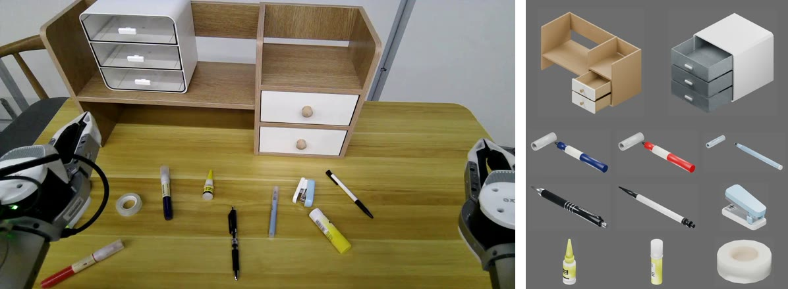

# 01 单图资产建模

从一张参考照片，为照片中的每件物品生成独立的三维资产：外观、碰撞形状、刚体划分和关节。尺寸和看不见的结构由 AI 根据图片和常识推断；质量、摩擦和物理测试在[第 2 章](02-physics-assets.md)。以[三抽屉盒子](../../asset_sources/objects/cabinet/000000/)（4 个刚体、3 个滑动关节）和[黑色圆珠笔](../../asset_sources/objects/pen/000000/)（2 个刚体、1 个滑动关节）为例。



## 交付物

| 交付物 | 位置 | 内容 |
| --- | --- | --- |
| 资产源码（进 Git） | `asset_sources/objects/<类别>/<编号>/` | `object.py`（建模，见[建模规范](../specs/modeling.md)）、`preview.json`（预览视角与运动）、`metadata.json`、`README.md`（含资产树）、`three_quarter.jpg` 缩略图 |
| 模型 | `assets/objects/<类别>/<编号>/object.blend` | 构建结果 |
| 预览 | `assets/objects/<类别>/<编号>/preview/` | `summary.json` 自动检查，各视角图片（左为外观，右为碰撞，碰撞按刚体着色），活动部件的运动视频 |

## 验收

**`summary.json`**：`status` 为 `passed`，`penetrations` 为空，刚体数和关节数与 README 一致；`complexity` 判断模型是否过细或过粗：

| 指标 | 典型值 | 盒子 | 笔 |
| --- | --- | --- | --- |
| `visual_triangles` 视觉三角面数 | 几百到一两千 | 588 | 1036 |
| `primitive_colliders` / `convex_colliders` 规则体（盒、圆柱等）/ 凸网格数 | 合计几十 | 21 / 12 | 2 / 35 |

**图片和视频**：外观与照片相符；碰撞完整覆盖外观，刚体划分合理；运动视频中抽屉、按钮等活动部件走完行程，没有穿透。盒子的开合视频：

<video controls preload="none" poster="images/cabinet-open.jpg" src="images/cabinet-open.mp4"></video>

## 命令

```bash
# 构建模型
blender -b --python-exit-code 1 -P scripts/assets/build_assets.py -- --assets cabinet/000000 pen/000000
# 自动检查并渲染预览
uv run python scripts/assets/validate_and_preview.py --source assets/objects --assets cabinet/000000 pen/000000
# 导出资产树，核对后写进 README
blender -b --python-exit-code 1 -P scripts/assets/export_asset_tree.py -- \
  assets/objects/cabinet/000000/object.blend --output outputs/cabinet-tree.txt
# 从预览生成缩略图
ffmpeg -hide_banner -loglevel error -y -i assets/objects/pen/000000/preview/three_quarter.jpg \
  -vf scale=480:240 -q:v 2 -frames:v 1 asset_sources/objects/pen/000000/three_quarter.jpg
```

其他参数用 `--help` 查看。

## 不通过时

记下问题所在的图片或视频帧：形状和结构问题改 `object.py`，视角和运动问题改 `preview.json`，然后重新构建和预览。
